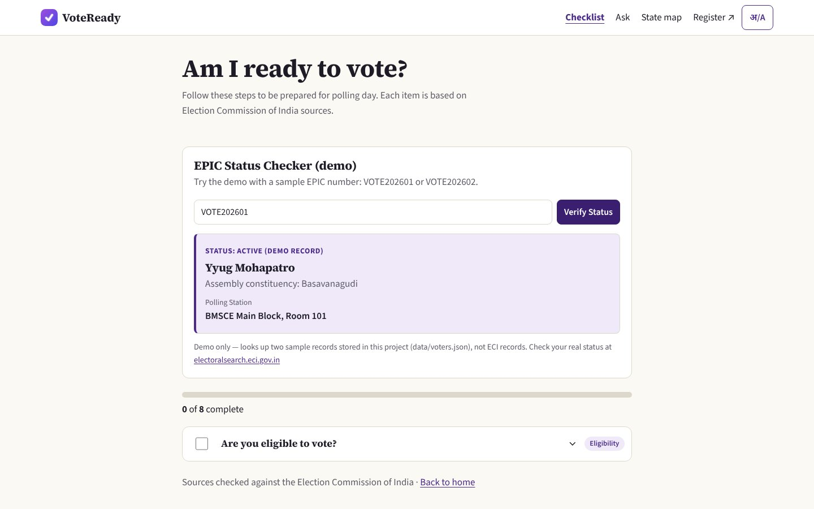
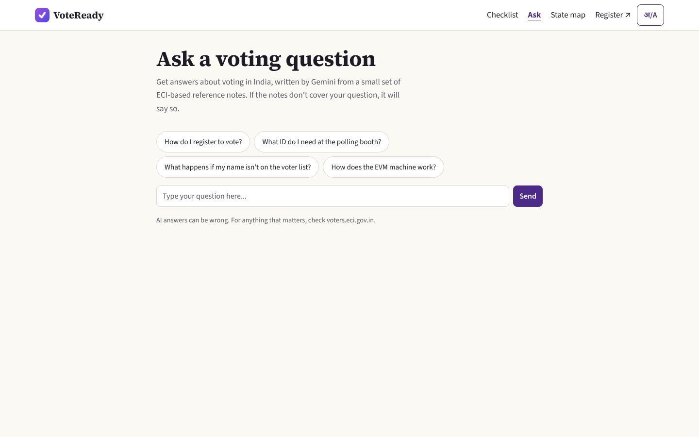
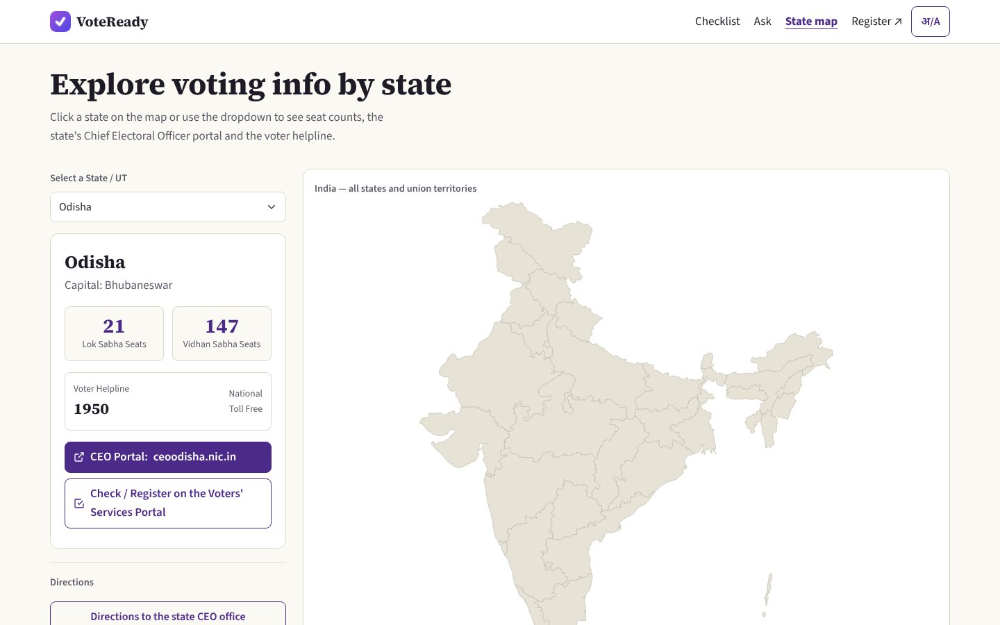
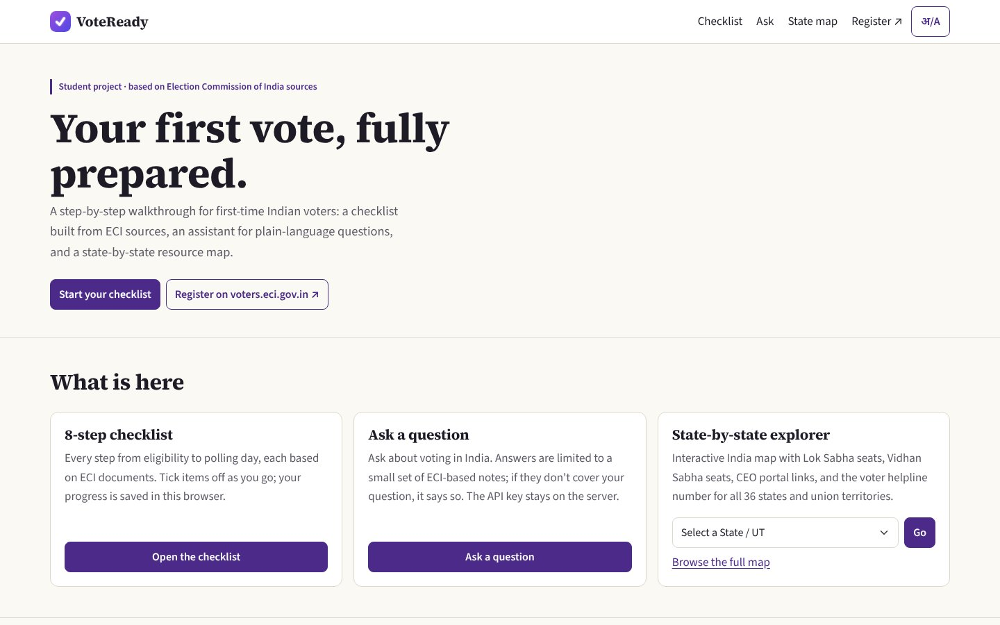

# VoteReady

**Live:** [voteready-pi.vercel.app](https://voteready-pi.vercel.app/)

A guided walkthrough for first-time Indian voters (18–22) preparing to cast their first vote in a general election. 

## What it does

VoteReady answers the question "I just turned 18 — now what?" through three features:

- **Am I Ready?** — An 8-step checklist covering eligibility, registration via Form 6, polling booth lookup, accepted documents, and what to do if your name is missing from the electoral roll.

- **Ask a Question** — A Gemini-powered Q&A that answers natural questions about voting in India, grounded in verified ECI reference data.

- **State Map** — An interactive map of all 36 states and union territories with Lok Sabha and Vidhan Sabha seat counts, the state Chief Electoral Officer (CEO) portal link and the 1950 voter helpline. It does not show polling schedules or booth locations; find your booth at [voters.eci.gov.in](https://voters.eci.gov.in).

## Screenshots

| Checklist | Q&A | Map | Landing |
|-----------|-----|-----|---------|
|  |  |  |  |

## How content is verified

Every factual claim in VoteReady is checked against primary ECI sources — not against the app's own output, and not against AI-generated text. The verification sources are:

1. **ECI Manual on EVM, Edition 8, August 2023** — voting process, VVPAT slip duration, button details
2. **ECI FAQs on EVM** ([eci.gov.in/evm-faqs](https://eci.gov.in/evm-faqs), last updated July 15, 2025) — 129 FAQs covering procedures, safeguards, and common misconceptions
3. **PIB Press Release PRID 2177191** (10 Oct 2025) — the specific list of 12 alternative voter photo IDs
4. **Voters' Service Portal** ([voters.eci.gov.in](https://voters.eci.gov.in)) — Form 6, electoral roll search, qualifying dates

Claims that could not be verified against these sources were removed rather than kept as plausible guesses. The Q&A system prompt explicitly instructs the model to say "I don't know" rather than fabricate answers.

## Tech stack

- Plain HTML, CSS and JavaScript, no build step; Bootstrap 5.3 (CDN) with a small theme in `assets/site.css`; D3 for the map
- Gemini 2.5 Flash for the Q&A feature
- Vercel serverless function (`api/gemini.js`) as a proxy — the API key lives in Vercel environment variables and is never exposed to the browser
- localStorage for checklist state persistence
- Static JSON for verified ECI content

## Running locally

```bash
git clone https://github.com/rajyyug1132/voteready.git
cd voteready
python -m http.server 8000
```

Open [localhost:8000](http://localhost:8000). The checklist and map work without any setup.

For the Q&A feature, deploy to Vercel and set the `GEMINI_API_KEY` environment variable in your Vercel project settings. The serverless proxy at `api/gemini.js` handles the API call server-side. Get a key at [aistudio.google.com/apikey](https://aistudio.google.com/apikey).

For the map routing feature, also set `GOOGLE_MAPS_KEY` in Vercel environment variables. The Maps API key is loaded dynamically via `api/maps-config.js` and is never hardcoded in client-side HTML. Restrict the key to your production domain in the Google Cloud Console.

## Why this exists

First-time voters often don't know the steps: how to register with Form 6, how to check the electoral roll, what to carry on polling day, and what happens inside the booth. VoteReady walks through them in plain language and links to the official ECI tool for each step.

## Engineering tradeoffs

The Q&A sends Gemini 2.5 Flash a fixed reference block of about 3,000 characters in the system prompt, written from the ECI and PIB sources above. That is simple and needs no retrieval step, but it only works while the reference stays small, and the model can still answer wrongly, so answers do not replace voters.eci.gov.in.

The server builds the system prompt, accepts only a question and a validated list of checklist step IDs, caps the question at 500 characters and sets the temperature to 0.1. This is hardening, not immunity: a user cannot change the instructions or the reference text, but prompt injection is not ruled out. If the reference grows to cover state-specific rules, it will need retrieval instead of a bigger prompt.

## Project status

Built solo during PromptWars Virtual 2026 (April 23 – May 3, 2026). See `PROMPTS.md` for the build log.
